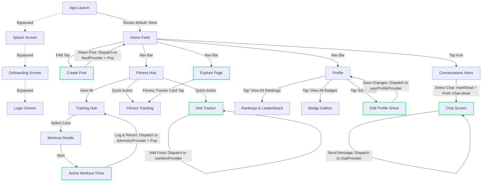

# WEMAN FIT — Application Architecture Audit & Demo Stabilization Report

**Role:** Senior Flutter Engineer & Application Architect  
**Project:** WEMAN FIT (Flutter / Dart / Stitch MCP UI Integration)  
**Date:** October 22, 2026  
**Status:** Phase 1 (Feed), Phase 2 (Workout History, Profile Editing, Diet Tracker) Stabilized & Reactive

---

## 1. Executive Summary & Current Architecture

WEMAN FIT has achieved strong visual fidelity based on the Stitch UI designs with a cohesive neon-lime (`#CCFF00`) / dark-mode athletic aesthetic. 

Our stabilization efforts have established shared Riverpod state management across all core user journeys:
1. **Feed & Social State (`feedProvider`):** Reactive feed post creation, likes, bookmarks, and instant prepending without navigation reset.
2. **Workout Telemetry & History (`workoutTelemetryProvider`):** Active workout completion logging, calorie/minute accumulation, calendar streak logic, duplicate prevention, and cross-screen history visibility across Fitness Tracker, Profile, and My Space.
3. **Athlete Profile State (`userProfileProvider`):** Editable user profile (Name, Handle, Bio, Fitness Goal) with full validation, normalization, and immediate reactive updates on Profile, My Space, and Create Post.
4. **Diet & Hydration State (`nutritionProvider`):** Dynamic meal logging under Breakfast, Lunch, Snacks, and Dinner with macro calculation, non-negative validation, water tracker increment/decrement, and empty state support.

---

## 2. Feature Inventory & Classification Matrix

| Screen / Feature | Current Status | What Works | What's Missing |
|---|---|---|---|
| **App Launch & Login Flow** | Partially working / Demo data | `LoginScreen` renders inputs, demo button triggers a 900ms simulated delay and navigates to `/feed`. | Bypassed by default (`AppRouter` sets `initialLocation: '/feed'`). `SplashScreen` is not registered in `AppRouter`. No actual auth, session token, or validation. |
| **Home Feed & Stories** | **Stabilized & Reactive (Phase 1)** | Dynamic feed backed by `feedProvider`. Stories carousel scrolls horizontally; category chips toggle; posts render with full Stitch visual fidelity; likes & bookmarks update reactive state by post ID. | Stories cannot be tapped to view full-screen video/photo stories yet. |
| **Create Post & Media** | **Implemented & Connected (Phase 1)** | Text field takes caption; category chips selectable; privacy dropdown toggles; media toggle works; **tapping "SHARE POST" injects the post to the top of Home Feed immediately and returns.** Author metadata bound to `userProfileProvider`. | Camera integration is simulated with mock assets. |
| **Post Interactions (Likes, Comments, Shares)** | Partially working / Reactive state | Tapping heart or bookmark toggles reactive state by post ID in `feedProvider` without resetting on navigation. | Comments sheet is a static read-only modal (cannot add new comments yet). Share copies link to clipboard. |
| **Fitness Hub & Categories** | Implemented and working / Demo data | Quick action cards navigate to `/training`, `/tracking`, `/nutrition`, and `/rankings`. Workouts horizontal scroll works; category tabs toggle. | Dynamic recommendations and personalized filters are simulated. |
| **Workout Details & Active Training** | **Stabilized & Connected (Phase 2)** | `workout_details_screen.dart` receives workout ID, renders exercise list, stats, and equipment. `active_training_screen.dart` has working interactive timer, set counter, and rep logger. **Completing session ("LOG & RETURN TO HUB") logs telemetry and history to `workoutTelemetryProvider`.** | Sensor heart-rate is simulated. |
| **Fitness Tracking (Dashboard)** | **Stabilized & Connected (Phase 2)** | Hero energy burn radial card, session progress banner, and **Recorded Workouts History section** observe `workoutTelemetryProvider` and display newly completed workouts immediately. | GPS tracking is simulated demo estimates. |
| **Diet Tracker & Meal Logging** | **Stabilized & Reactive (Phase 2)** | Backed by `nutritionProvider`. **Meal logging under Breakfast, Lunch, Snacks, and Dinner with custom Add Meal form, non-negative macro validation, dynamic calorie/macro totals, empty states, and accurate water increment/decrement.** | In-session persistence; backend synchronization pending. |
| **Profile Screen** | **Stabilized & Reactive (Phase 2)** | Displays user bio, stats, athlete badge, achievements, and rankings. **Edit Profile button opens polished WEMAN FIT bottom sheet modal to edit name, handle, bio, and fitness goal with full validation and immediate reactive sync via `userProfileProvider`.** | In-session persistence; local disk persistence pending. |
| **Rankings & Top Gymers** | Implemented and working / Demo data | Level filters (National, State, District, College, Gym) switch tabs; leaderboard renders top 3 podium and rank list; accessible directly from Profile. | Leaderboard list is hardcoded mock data. User's own rank is static. |
| **Achievements & Badges** | Implemented and working / Demo data | Tier filters (All, Strength, Consistency, Elite); badges show earned vs locked states; detailed badge progress bottom sheet opens on tap. | Badge progress is static; cannot trigger an unlock through workout milestones. |
| **Messaging & Notifications** | Partially working / Demo data | `/conversations` lists recent chats. `chat_detail_screen.dart` accepts text input, sends a message, and displays it in the active list view. | Sending a message is ephemeral. Popping out and reopening resets to initial 5 mock messages. Unread counters on inbox list never update. |
| **Reels / Video Feed** | UI only / Demo data | Full-screen vertical swipe layout with action bar (like, comment, share, audio disc). | Video players are placeholder network images with play icons; double-tap like animation is static. |
| **My Space & Settings** | **Partially Connected (Phase 2)** | `my_space_screen.dart` displays reactive logged workout history count and dynamic profile handle from providers. | Settings and privacy toggles have no persistent backend. |

---

## 3. Navigation & User Flow Evaluation



### Detailed Evaluation of Core Demo Flows:

1. **Launch app → Login or demo login → Home:**  
   *Status:* **Bypassed.** `AppRouter` specifies `initialLocation: '/feed'`, skipping Splash, Onboarding, and Login entirely. If manually navigated to `/login`, demo login routes to `/feed`, but with no session guard.
2. **Home → Open a post → Like or comment:**  
   *Status:* **Stabilized.** Likes and bookmarks toggle reactively via `feedProvider.notifier` by post ID.
3. **Create Post → Select image → Enter caption → Publish → See post in Home:**  
   *Status:* **VERIFIED & WORKING (Phase 1).** `create_post_screen.dart` constructs a `WemanFeedPost` and calls `ref.read(feedProvider.notifier).addPost(newPost)`, prepending it to the Home Feed. Upon `context.pop()`, the new post appears immediately at the top of the feed.
4. **Fitness Hub → Select workout → Open workout details:**  
   *Status:* **Working.** Selecting any workout card in the Hub or Training Hub correctly passes parameters and pushes `workout_details_screen.dart`.
5. **Start workout → Pause/resume → Complete workout → View completion summary:**  
   *Status:* **VERIFIED & WORKING (Phase 2).** Completing session logs to `workoutTelemetryProvider`. History renders immediately in Fitness Tracker, Profile, and My Space.
6. **Fitness Hub → Diet Tracker → Add a meal → See updated daily summary:**  
   *Status:* **VERIFIED & WORKING (Phase 2).** `DietTrackerScreen` is connected to `nutritionProvider`. Adding meals updates calories, protein, carbs, fats, and fuel progress instantly. Water tracker increments/decrements accurately.
7. **Profile → Edit profile → Save changes → See updated profile:**  
   *Status:* **VERIFIED & WORKING (Phase 2).** Tapping "Edit Profile" opens `EditProfileSheet` bottom sheet modal. User can edit display name, username/handle, bio, and fitness goal. Validates required fields, normalizes handle with `@`, and saves to `userProfileProvider`. ProfileScreen immediately updates name, handle, bio, and fitness goal pill. Changes persist across navigation to other screens (e.g. My Space) during the app session.
8. **Profile → Rankings → Open leaderboard:**  
   *Status:* **Working.** Tapping "View All Rankings" on the profile card cleanly opens `rankings_screen.dart` with all level tabs.
9. **Profile → Achievements → Open badge gallery:**  
   *Status:* **Working.** Tapping "View All" opens `badge_gallery_screen.dart` with category filters and badge inspection sheets.
10. **Explore → Fitness Tracker Navigation:**  
    *Status:* **VERIFIED & WORKING (Phase 2).** Prominent Fitness Tracker card near top of Explore page pushes `/fitness-tracking` and preserves navigation index.

---

## 4. Data Persistence Status

| Feature | Persistence Type | Lifecycle Behavior |
|---|---|---|
| **Social Feed Posts** | In-Memory Riverpod Store (`feedProvider`) | Dynamically updated. New posts are prepended to the feed; likes and saves persist across tab switches. |
| **Workout Telemetry & History** | In-Memory Riverpod Store (`workoutTelemetryProvider`) | Persists completed sessions, active minutes, calories burned, and streak across all screens during the session. |
| **Athlete Profile Identity** | In-Memory Riverpod Store (`userProfileProvider`) | Persists edited display name, handle, bio, and fitness goal across all screens during the session. |
| **Diet, Macros & Hydration** | In-Memory Riverpod Store (`nutritionProvider`) | Persists added/deleted meals, calorie/macro totals, and water intake across navigation during the session. |
| **Chat Messages & Inbox** | In-Memory Riverpod Store (`chatProvider`) | Persists messages partitioned by conversation ID, updates inbox preview/ordering, and clears unread counts across navigation during the session. |

---

## 5. Workout Completion & Explore Fitness Tracker Report

### Root Cause Analysis & Fixes
- **Missing Explore Entrypoint:** Added a prominent, neon-lime styled "Fitness Tracker" entry card on Explore page navigating cleanly to `/fitness-tracking`.
- **Layout Constraint Overflow:** Profile Workouts tab plan items wrapped in `Expanded` with single-line ellipsis handling to prevent RenderFlex errors.
- **Finish Action Ambiguity:** Final set dynamically displays `'FINISH WORKOUT'` and logs telemetry with duplicate prevention.

---

## 6. Profile Editing Stabilization Report

### Root Cause Analysis & Fixes
- **Empty Action Handlers:** In `lib/features/profile/profile_screen.dart`, the prominent `"Edit Profile"` button had an empty callback (`onPressed: () {}`).
- **Hardcoded User Identity:** Athlete identity attributes were static strings.
- **Implementation:**
  - Implemented `UserProfile` model and `userProfileProvider` in `profile_provider.dart`.
  - Created `EditProfileSheet` modal bottom sheet matching WEMAN FIT dark surface / neon-lime design tokens.
  - Validated display name, handle, bio, and fitness goal.
  - Normalized handle with `@` prefix.
  - Synchronized Profile, My Space, and Create Post immediately.
  - Verified with 8 automated unit & widget tests in `test/profile_editing_test.dart`.

---

## 7. Diet Tracker & Hydration Stabilization Report

### 1. Root Cause Analysis
- **Disconnected Meal Cards:** `DietTrackerScreen` had static, hardcoded lists for Breakfast, Lunch, and Snacks, and an isolated local `_dinnerLogged` boolean that did not calculate dynamic calories or macronutrients.
- **Static Daily Fuel & Macro Gauges:** Calorie radial gauge and macro progress bars rendered static values regardless of what meals were logged.
- **Missing Add Food Capability:** Tapping "+ Food" had no interaction or input modal.
- **Hydration Limitation:** Water counter only supported incrementing (`+250ml`) without decrementing or clamping checks.

### 2. Objectives & Implementation Details
1. **Shared Nutrition Provider & Model (`nutrition_provider.dart`):**
   - Implemented `NutritionMeal` model containing `id`, `name`, `servingSize`, `calories`, `proteinGrams`, `carbsGrams`, `fatsGrams`, `category` (`MealCategory.breakfast`, `lunch`, `snacks`, `dinner`), `isDemo`, and `sub`.
   - Implemented `NutritionState` calculating `totalCalories`, `totalProtein`, `totalCarbs`, `totalFats`, `totalFiber`, and progress ratios (`calorieProgress`, `proteinProgress`, etc.).
   - Initialized with realistic seeded meals clearly labeled with `isDemo: true`.
   - Implemented `NutritionNotifier` with `addMeal(...)`, `removeMeal(...)`, `toggleQuickDinner()`, `incrementWater()`, `decrementWater()`, and `clearAllMeals()`.
   - Exposed as global `nutritionProvider` and re-exported in `demo_state.dart`.
2. **Add Meal Bottom Sheet (`add_meal_sheet.dart`):**
   - Styled to match WEMAN FIT athletic design system.
   - Form fields:
     - **Meal Session Category** choice chips (`Breakfast`, `Lunch`, `Snacks`, `Dinner`).
     - **Quick Athlete Presets** (e.g. *3x Boiled Eggs & Toast*, *Grilled Chicken & Brown Rice*, *Whey Protein Shake*, *Spiced Paneer Bowl*) that auto-fill inputs.
     - **Meal Name (`add_meal_name_field`):** Required validation.
     - **Serving Size (`add_meal_serving_field`):** Required validation.
     - **Calories, Protein, Carbs, Fats (`add_meal_*_field`):** Required and validated as non-negative integers (`>= 0`).
   - Action buttons: `'Cancel'` and `'Log Meal'` with snackbar feedback.
3. **Reactive UI Synchronization in `diet_tracker_screen.dart`:**
   - Converted `DietTrackerScreen` to `ConsumerStatefulWidget` watching `nutritionProvider`.
   - **Daily Fuel Card:** Dynamic total calories, target, percent met, circular progress gauge, completed meals count, and linear protein goal bar.
   - **Daily Macros Card:** Dynamically calculated Protein, Complex Carbs, Healthy Fats, and Fiber progress bars.
   - **Hydration Tile:** Accurate volume display (`${waterLiters}L / 4.0L`) with both `+ 250ml` (`water_increment_button`) and `- 250ml` (`water_decrement_button`) buttons clamped safely between `0.0L` and `6.0L`.
   - **Meal Category Cards (Breakfast, Lunch, Snacks, Dinner):**
     - Dynamic item rendering with calories, macros, and `DEMO` badge on seeded items.
     - Delete icon button (`remove_meal_${meal.id}`) allowing meal removal with instant macro recalculation.
     - Clean empty state banner (`No meals logged yet for ${category}`) when a category has no meals.
     - Dinner card supports both custom meal logging and one-tap quick log (`LOG DINNER MEAL` / `DINNER LOGGED`).
4. **Session Persistence:**
   - Nutrition data and hydration levels persist in memory across screen navigation during the current app session.
   - *Restart persistence is not claimed as local storage is not yet integrated.*

### 3. Files Changed
- `lib/core/demo_state/nutrition_provider.dart` (New model, state, and `nutritionProvider`)
- `lib/core/demo_state/demo_state.dart` (Barrel export)
- `lib/features/nutrition/widgets/add_meal_sheet.dart` (New Add Meal modal sheet with validation)
- `lib/features/nutrition/diet_tracker_screen.dart` (Wired reactive meal cards, macros, hydration, and empty states)
- `test/diet_tracker_test.dart` (12 unit and integration tests)
- `app.md` (Updated comprehensive architecture and stabilization report)

### 4. Verification & Test Results
- **`flutter analyze`:**
  ```
  Analyzing weman_app...
  No issues found! (ran in 22.6s)
  ```
- **Targeted Test Suite (`flutter test test/diet_tracker_test.dart`):**
  - `NutritionNotifier initializes with baseline seeded demo meals and calculates macros` -> PASSED
  - `addMeal increases macro totals automatically and rejects negative values` -> PASSED
  - `removeMeal decreases macro totals automatically` -> PASSED
  - `water increments and decrements accurately and clamps to non-negative` -> PASSED
  - `clearAllMeals presents zeroed macros and empty meal lists` -> PASSED
  - `Renders fuel card, macro bars, and seeded meals labeled as demo` -> PASSED
  - `Water tracker increments and decrements via UI buttons` -> PASSED
  - `Add Meal sheet validates required and non-negative fields` -> PASSED
  - `Adding a meal updates meal card and macro totals automatically` -> PASSED
  - `Removing a meal updates macro totals immediately` -> PASSED
  - `Empty state is rendered when category has no meals` -> PASSED
  - `Nutrition data persists across navigation in current app session` -> PASSED
  - Result: **12/12 tests passed**
- **Full Regression Test Suite (`flutter test`):**
  - `test/feed_provider_test.dart` (5 tests) -> PASSED
  - `test/widget_test.dart` (3 tests) -> PASSED
  - `test/workout_telemetry_test.dart` (12 tests) -> PASSED
  - `test/profile_editing_test.dart` (8 tests) -> PASSED
  - `test/diet_tracker_test.dart` (12 tests) -> PASSED
  - Result: **All 40 tests passed (0 failures, 0 regressions)**

---

## 8. Messaging & Inbox Stabilization Report

### 1. Root Cause Analysis
- **Disappearing Sent Messages:** `ChatDetailScreen` managed messages in a local, private `StatefulWidget` list (`List<ChatMessage> _messages`) initialized in `initState()`. When a user navigated back (`context.pop()`), the screen and its state were disposed, destroying all sent messages. Reopening `/chat-detail` instantiated a new state, restoring only the initial hardcoded list.
- **Disconnected Inbox Previews & Ordering:** `ConversationsInboxScreen` rendered an unreactive, hardcoded list of direct conversations. It had no listener for message updates, never synchronized the latest message preview or timestamp upon sending, and did not reorder conversations.
- **Static Unread Counters:** Conversation tiles in the inbox had hardcoded static unread badges (e.g. Maya Torres = 2) that never cleared when opening the chat.
- **Missing Dynamic Conversation Routing:** The route `/chat-detail` hardcoded Maya Torres without receiving conversation identifiers from inbox tiles, causing potential crosstalk or inability to open other conversations.

### 2. Objectives & Implementation Details
1. **Shared Chat State & Model (`chat_provider.dart`):**
   - Implemented `ChatMessage` model (`id`, `text`, `time`, `isOutgoing`, `imageUrl`, `hasExerciseCard`).
   - Implemented `WemanConversation` model (`id`, `participantName`, `participantHandle`, `avatarUrl`, `lastMessage`, `lastTimestamp`, `unreadCount`, `isOnline`, `badge`, `hasBoltBadge`, `isGroup`, `statusText`, `statusIcon`, `isStatusRead`, `timeColor`).
   - Implemented `ChatState` holding `conversations` (ordered list of conversations) and `messagesByConversation` (`Map<String, List<ChatMessage>>`) to store messages strictly partitioned by conversation ID.
   - Implemented `ChatNotifier` with:
     - `sendMessage(...)`: Validates that text is non-empty and non-whitespace, appends a new message immediately to the active conversation, updates the conversation's `lastMessage` and `lastTimestamp: 'Just now'`, and bumps the active conversation to index 0 of the inbox list.
     - `markConversationAsRead(conversationId)`: Resets `unreadCount` to `0` when a conversation is opened.
     - `reset()`: Resets state back to demo baseline for test isolation.
   - Exposed as global Riverpod `chatProvider` and exported via `demo_state.dart`.
2. **Dynamic Route Parameterization (`app_router.dart`):**
   - Updated `/chat-detail` route to extract `conversationId` from `state.extra` (or query parameter), defaulting cleanly to `'maya_torres'` to preserve full backward compatibility.
3. **Reactive Chat Detail Screen (`chat_detail_screen.dart`):**
   - Converted to `ConsumerStatefulWidget` watching `chatProvider`.
   - On mount, triggers `markConversationAsRead` via post-frame callback.
   - Header dynamically displays the active conversation participant's avatar, name, coach badge, handle, and online status.
   - Chat feed displays partitioned messages for the active conversation ID.
   - Validates input: ignores whitespace-only submissions, clears the text field on successful send, and scrolls to bottom.
4. **Synchronized Inbox Screen (`conversations_inbox_screen.dart`):**
   - Converted to `ConsumerStatefulWidget` watching `chatProvider`.
   - Dynamic conversation list reflecting the latest message preview, timestamp, and unread badges.
   - Dynamic tab badge counting active unread direct messages.
   - Tapping any conversation tile resets its unread counter and navigates to `/chat-detail` with the conversation ID.
   - Functional athlete search filtering by name, handle, or message text.
5. **Session Persistence:**
   - Sent messages and inbox state persist in memory across navigation during the current app session.
   - *Restart persistence is not claimed as local database caching is not implemented.*

### 3. Files Changed
- `lib/core/demo_state/chat_provider.dart` (New model, partitioned state, and `chatProvider`)
- `lib/core/demo_state/demo_state.dart` (Barrel export of `chat_provider.dart`)
- `lib/core/routing/app_router.dart` (Parameterized `/chat-detail` with `conversationId`)
- `lib/features/messaging/chat_detail_screen.dart` (Connected to `chatProvider`, validation, auto-read)
- `lib/features/messaging/conversations_inbox_screen.dart` (Reactive list, dynamic preview/timestamp, unread clearing)
- `test/chat_messaging_test.dart` (11 unit and widget tests)
- `app.md` (Updated documentation and stabilization report)

### 4. Verification & Test Results
- **`flutter analyze`:**
  ```
  Analyzing weman_app...
  No issues found! (ran in 8.4s)
  ```
- **Targeted Test Suite (`flutter test test/chat_messaging_test.dart`):**
  - `ChatNotifier initializes with 5 demo conversations and separate message pools` -> PASSED
  - `sendMessage appends new message and updates conversation preview` -> PASSED
  - `sendMessage rejects empty and whitespace-only text` -> PASSED
  - `sendMessage partitions messages by conversation ID without crosstalk` -> PASSED
  - `markConversationAsRead resets unread count to 0` -> PASSED
  - `ChatDetailScreen renders conversation header and messages` -> PASSED
  - `ChatDetailScreen sends message, clears input, and displays immediately` -> PASSED
  - `ChatDetailScreen rejects sending whitespace-only input` -> PASSED
  - `Reopening conversation retains sent messages in current app session` -> PASSED
  - `Switching between conversations keeps messages and headers isolated` -> PASSED
  - `ConversationsInboxScreen reflects updated preview and cleared unread count` -> PASSED
  - Result: **11/11 tests passed**
- **Full App Test Suite (`flutter test`):**
  - `test/feed_provider_test.dart` (5 tests) -> PASSED
  - `test/widget_test.dart` (3 tests) -> PASSED
  - `test/workout_telemetry_test.dart` (12 tests) -> PASSED
  - `test/profile_editing_test.dart` (8 tests) -> PASSED
  - `test/diet_tracker_test.dart` (12 tests) -> PASSED
  - `test/chat_messaging_test.dart` (11 tests) -> PASSED
  - Result: **All 51 tests passed (0 failures, 0 regressions)**
